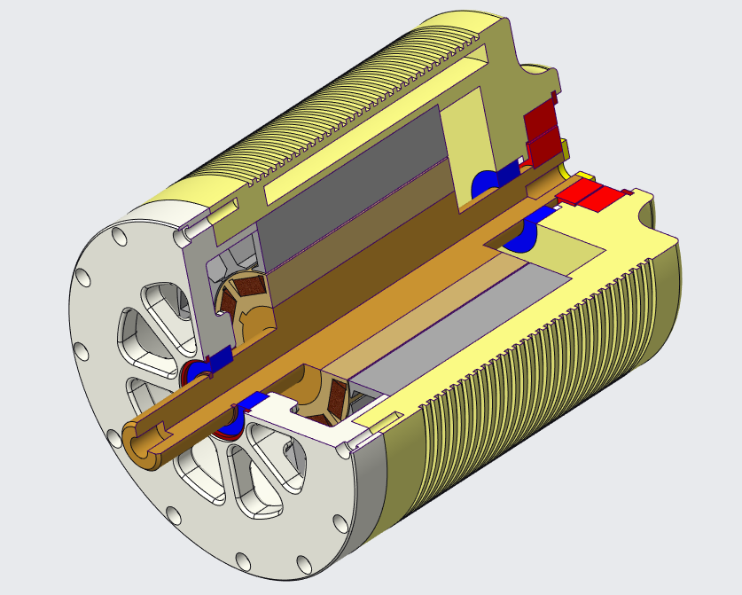
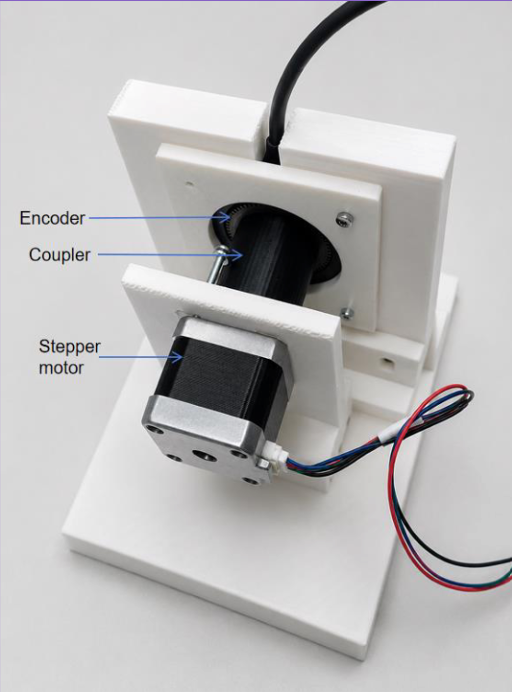

# Adarsh Puranik | Engineering Portfolio

**Mechatronics · Hardware development · Electric drives · Real-time control**

I build at the intersection of mechanical design, electronics and control engineering. My experience spans early-stage product development at Orxa Energies and engineering at scale at BMW Motorrad.

**[Open the visual portfolio website](https://adarshpuranikap-eng.github.io/Engineering_Portfolio/)** · [Engineering documentation](#explore-my-work) · [References](#references--recognition)

## Selected work

| Electric machine design | Experimental hardware |
| :---: | :---: |
|  |  |
| **Formula Student IPMSM** | **Real-time encoder instrumentation** |
| 95.7% modelled torque-ripple RMS reduction | 80 Hz speed-measurement output |
| [Research and results](projects/formula-student-ipmsm/research/vehicles-submitted-manuscript.pdf#page=18) · [CAD assembly](projects/formula-student-ipmsm/cad/traction-motor-assembly.stp) | [Prototype and tests](projects/encoder-instrumentation/documents/scientific-project-presentation.pdf#page=24) · [Algorithm](projects/encoder-instrumentation/documents/scientific-project-presentation.pdf#page=22) |

## Explore my work

| Project | Direct access |
|---|---|
| Motor mechanical integration | [Second CAD view](projects/formula-student-ipmsm/images/quarter-section-02.png) · [Assembly details](projects/formula-student-ipmsm/research/vehicles-submitted-manuscript.pdf#page=4) · [Individual STEP models](projects/formula-student-ipmsm/cad/) |
| Motor control and modelling | [Learning convergence](projects/formula-student-ipmsm/research/vehicles-submitted-manuscript.pdf#page=18) · [Endurance results](projects/formula-student-ipmsm/research/vehicles-submitted-manuscript.pdf#page=19) · [Research manuscript](projects/formula-student-ipmsm/research/vehicles-submitted-manuscript.pdf) |
| Encoder signal processing | [Architecture](projects/encoder-instrumentation/documents/scientific-project-presentation.pdf#page=22) · [Selection](projects/encoder-instrumentation/documents/scientific-project-presentation.pdf#page=23) · [Position and direction](projects/encoder-instrumentation/documents/scientific-project-presentation.pdf#page=25) · [Velocity](projects/encoder-instrumentation/documents/scientific-project-presentation.pdf#page=26) · [Zero-speed detection](projects/encoder-instrumentation/documents/scientific-project-presentation.pdf#page=27) |
| Mechanical calculations and tooling | [Bearing life](projects/industrial/calculations/bearing-life.xlsx) · [Removal fixture](projects/industrial/calculations/motor-bearing-core-removal-fixture.xlsx) |
| Professional experience | [Orxa and BMW](projects/industrial-experience.md) · [Industrial project overview](projects/industrial/) |

## References & recognition

- [Professional and academic references](credentials/): BMW Motorrad, Orxa Energies, RWU thesis supervisor and second examiner.
- [Formula Bharat 2019 certificate](credentials/certificates/formula-bharat-2019.pdf) · [Transmission engineering publication certificate](credentials/certificates/irjet-transmission-publication-2021.pdf)

The torque-ripple result is model-based, not a physical motor test. The trailer project was collaborative; my individual contribution was encoder instrumentation and the bench test. The research manuscript is identified by its submission status. Third-party material requires appropriate publication permission.

[Full asset inventory](ASSET-INVENTORY.md) · [LinkedIn](https://www.linkedin.com/in/adarsh-puranik-234999211)
