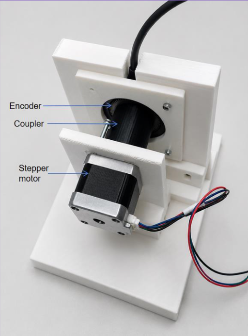

# Electrified cargo trailer | Encoder instrumentation

**RWU scientific project, August 2026.**

## Individual contribution
Encoder selection, quadrature decoding, period-based speed estimation in Simulink Real-Time on Speedgoat IO397, and a stepper-driven proof-of-concept test rig.

| Parameter | Design choice |
|---|---|
| Wheel | 12 inch |
| Encoder | 1024 PPR |
| Quadrature decoding | 2×, 2048 counts/revolution |
| Output | 80 Hz |

## Evidence
[Scientific project presentation (PDF)](documents/scientific-project-presentation.pdf)

Slides 20–27 document the individual contribution:
- Slide 22: signal processing and period-based measurement architecture.
- Slide 23: wheel and encoder selection.
- Slide 24: physical encoder, coupler and stepper motor test rig.
- Slides 25–27: position, direction, velocity and zero-velocity indication.

The EKF and odometry suspension were teammates' work. Full trailer reference-system validation was future work at the presentation. The physical bench tests should not be confused with completed vehicle validation.

## Visual evidence

[Prototype test rig — presentation, page 24](documents/scientific-project-presentation.pdf#page=24) · [Experimental results — page 25 onward](documents/scientific-project-presentation.pdf#page=25).

## Physical prototype

