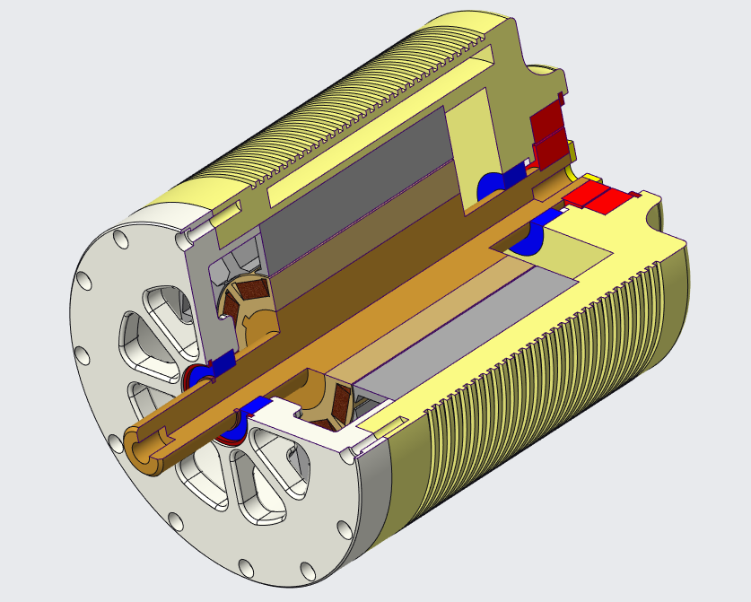
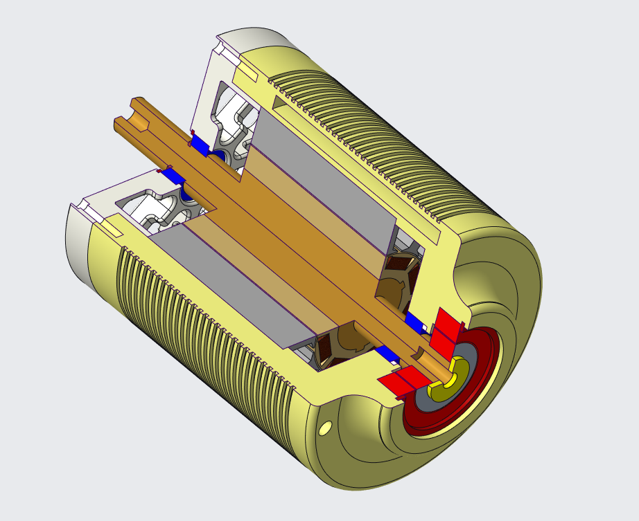

# Formula Student IPMSM | Mechanical integration and control

**Context:** RWU / Formula Student Team Weingarten collaboration, 2026.

## Engineering contribution
The project builds upon an existing electromagnetic concept rather than claiming a new motor topology. Detailed mechanical integration in PTC Creo addresses the rotor, stator, shaft, bearings, resolver, housing and cooling passages. The control study uses FEA-derived data, nonlinear torque reconstruction and offline norm-optimal harmonic iterative learning control.

## Results and limits
- Eight poles and twelve slots.
- 9,605 endurance-derived calibration nodes.
- 95.7% endurance-time-weighted modelled torque-ripple RMS reduction.
- Physical motor/inverter testing, final mechanical verification and thermal validation remain outside the verified scope.

## Files
- [STEP assembly](cad/traction-motor-assembly.stp) — open in a compatible CAD viewer.
- [Submitted Vehicles manuscript](research/vehicles-submitted-manuscript.pdf) — see Figure 2 for mechanical assembly views, Figures 8–12 for control results. Coauthored; submitted October 19, 2026, not represented as published.
- Additional NOILC PDF is catalogued in the review directory; its contents have not been independently inspected.

Publication and redistribution rights should be confirmed for collaborative assets.

## CAD gallery

## Individual CAD components

| Part | STEP file |
|---|---|
| Complete assembly | [traction-motor-assembly.stp](cad/traction-motor-assembly.stp) |
| Rotor | [rotor.stp](cad/rotor.stp) |
| Stator | [stator.stp](cad/stator.stp) |
| Shaft | [shaft.stp](cad/shaft.stp) |
| Housing | [housing.stp](cad/housing.stp) |
| End cover | [end-cover.stp](cad/end-cover.stp) |

STEP files can be opened in compatible CAD software. No claim is made that these files have been independently geometry-validated.
